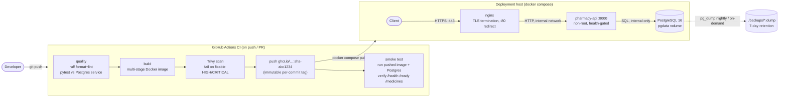

# Architecture — Pharmacy Management Platform

## System diagram



The same diagram as ASCII (renders anywhere):

```
 developer --git push--> [ GitHub Actions CI ]
                             | quality: ruff + pytest (Postgres service container)
                             v
                          build: multi-stage image --> Trivy gate --> GHCR :sha-<commit>
                             |
                             v smoke: boot image + Postgres, verify health/ready/API
                             |
        deployment host <----+ (docker compose pull, IMAGE_TAG=sha-<commit>)

  client --HTTPS:443--> nginx --internal--> app(non-root :8000) --internal--> postgres(+volume)
```

## Components

| Component | Technology | Why this choice |
|---|---|---|
| API | FastAPI + SQLAlchemy 2 | validation via Pydantic (`gt=0` rules), sync ORM keeps transactions/locking explicit and demoable |
| Database | PostgreSQL 16 (Alpine) | real `SELECT … FOR UPDATE`, real `pg_dump`/`pg_restore` for the backup requirement |
| Proxy | nginx 1.27 (Alpine) | TLS termination, HTTP→HTTPS redirect, single published entrypoint |
| CI | GitHub Actions | free, public run pages double as submission evidence; `GITHUB_TOKEN` avoids long-lived secrets |
| Registry | GHCR | integrated with GitHub auth; immutable `sha-…` tags enable safe rollback |

## Request flow and guarantees

1. Client hits `https://…/sales` → nginx terminates TLS, proxies to `app:8000`
   (only reachable on the internal compose network).
2. Request middleware assigns an `X-Request-ID`, logs method/path/status/duration as JSON.
3. Pydantic validates the body (`quantity` must be a positive integer).
4. `service.sale()` opens one transaction:
   `SELECT … FOR UPDATE` on the batch row → **expire check → quantity check →
   decrement → insert StockMovement(balance_after)** → commit.
   - Concurrent sales serialise on the row lock → no oversell.
   - Any rejected sale raises before the mutation → nothing changes, nothing recorded.
5. A `CHECK (quantity >= 0)` DB constraint backstops the application rule.

## Deployment guarantees

- **Consistent build:** Python dependencies are declared with minimum versions
  in `pyproject.toml` (not yet lockfile-pinned); the multi-stage Dockerfile
  builds the same app image locally and in CI.
- **No start-order races:** `depends_on: condition: service_healthy` chains
  db → app → nginx.
- **Least privilege:** non-root app user; DB never published; app debug port
  bound to loopback only; secrets via environment, `.env` gitignored.
- **Recoverability:** `restart: unless-stopped` for container self-healing;
  `pool_pre_ping` for DB reconnect; documented backup/restore/rollback.

## What is deliberately out of scope (and where it would slot in)

- **HA/Kubernetes** — compose is the deployment seam; the app container is
  already stateless, so a K8s Deployment+Service would wrap it unchanged.
- **Alembic migrations** — schema bootstrap is `create_all`; Alembic is the
  documented next step once the schema churns.
- **Metrics/Prometheus** — stretch goal; health/readiness + structured logs
  cover the required observability.
