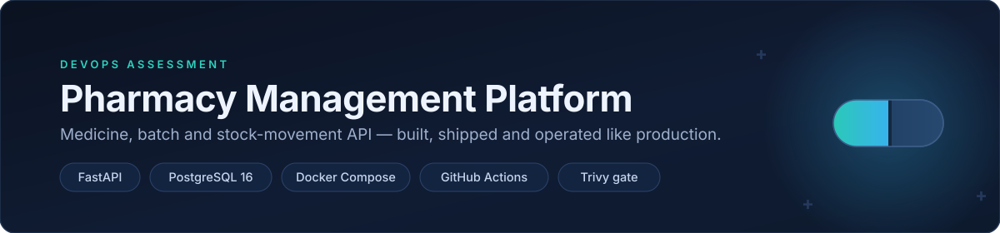
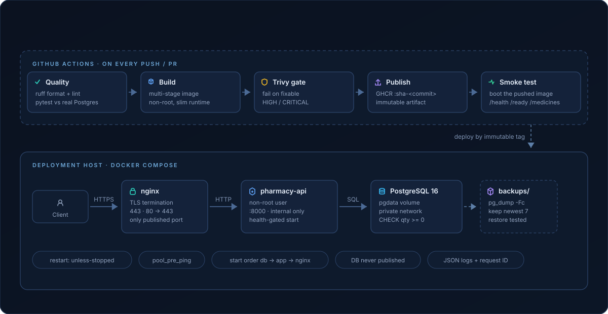
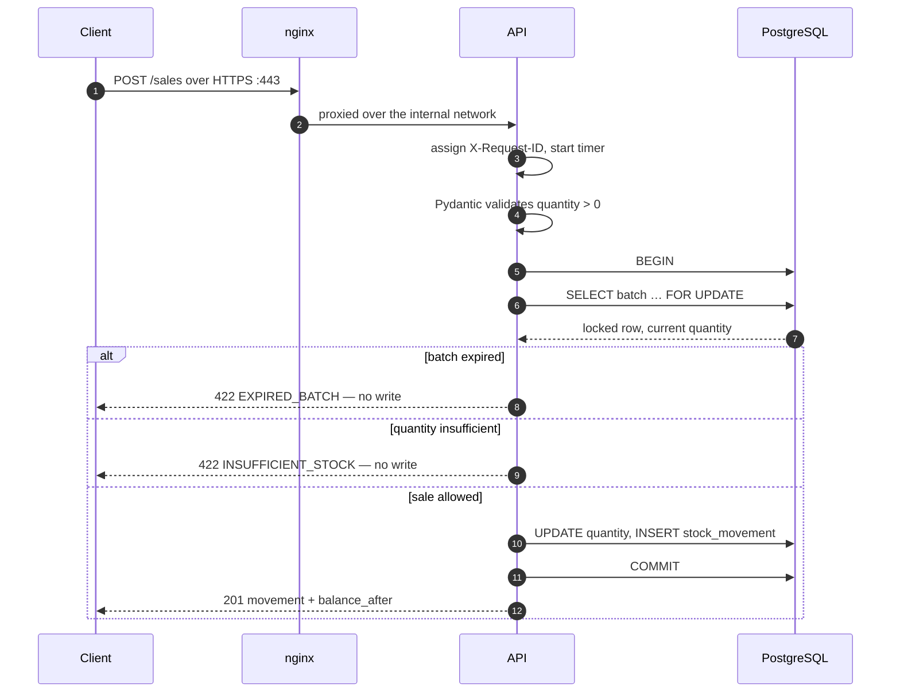
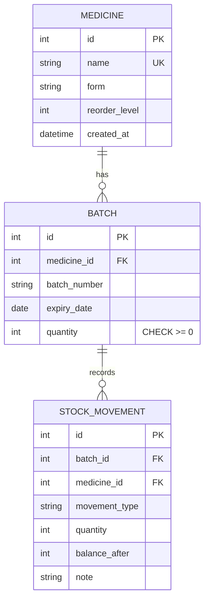
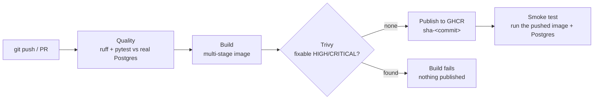

<p align="center">
  
</p>

<p align="center">
  <a href="https://github.com/Rahulx0/Phar/actions/workflows/ci.yml"></a>
  
  
  
  
  
  
  
</p>

<p align="center">
  <b>A small pharmacy stock service, built and operated with production habits:</b><br>
  containerised delivery · automated CI/CD · TLS edge · health checks · audit trail · tested backup, restore and rollback.
</p>

---

## Why this project exists

The Pharmacy Management Platform is a deliberately small domain service — medicines,
batches and stock movements. The engineering weight sits around it: how the service is
built, released, deployed, observed and recovered when something breaks.

The API is trimmed to what the domain needs so that the effort goes into the parts that
actually matter here: a reproducible image, a gated pipeline, a private network with a
single TLS entrypoint, honest health signals, and drills that prove the data can come back.

## At a glance

| Area | Detail |
|---|---|
| 🧾 **Domain** | Medicines, batches (with expiry dates), and an immutable stock-movement ledger |
| ⚙️ **Stack** | FastAPI · SQLAlchemy 2 · Pydantic v2 · PostgreSQL 16 · nginx |
| 🚢 **Delivery** | GitHub Actions → Trivy gate → GHCR image tagged `sha-<commit>` |
| 🖥️ **Runtime** | `docker compose`: db → app → nginx, with health-gated start order |
| 🔍 **Observability** | Split `/health` and `/ready` probes + structured JSON logs with request IDs |
| 🛟 **Recovery** | `pg_dump`/`pg_restore` with retention, plus rollback by immutable image tag |

## Architecture



Only nginx publishes a port. The API is reachable over the compose network, and PostgreSQL
is never exposed. CI produces an immutable image per commit; the deployment host runs that
exact artifact rather than rebuilding from source.

## How it works

### Request path



The row lock is the reason two pharmacists selling the last box cannot both succeed:
the second transaction blocks until the first commits, then re-reads the committed
quantity and fails its check.

### Data model



Every purchase, sale, return and adjustment appends a movement row with the resulting
balance, so stock can always be reconstructed from the ledger rather than trusted from a
single counter.

### Domain rules that are enforced, not documented

| Rule | Enforcement | Result |
|---|---|---|
| Quantities must be positive | Pydantic `quantity: gt=0` | `422` validation error |
| No sale from an expired batch | Service check inside the transaction | `422 EXPIRED_BATCH`, stock unchanged, no movement |
| No sale beyond available stock | Locked read, then quantity check | `422 INSUFFICIENT_STOCK`, stock unchanged |
| No oversell under concurrency | `SELECT … FOR UPDATE` per batch row | Concurrent sales serialise |
| Stock can never go negative | `CHECK (quantity >= 0)` | Database refuses the write even if the app is bypassed |

Rejections happen before any mutation, in the same transaction. Nothing is decremented and
nothing is recorded for a sale that fails.

### Release pipeline



Each stage exists to make a different failure impossible to ship:

- **Quality** runs the suite against a real PostgreSQL service container, because SQLite
  silently ignores `FOR UPDATE` and would let the concurrency test pass for the wrong reason.
- **Build** produces a two-stage image: dependencies are installed in a builder, and the
  runtime carries only the virtualenv, a non-root user and the app — no compilers, no pip.
- **Trivy** blocks the release on fixable HIGH/CRITICAL findings. Unfixed base-image issues
  are reported but do not fail the build, since there is no action to take on them.
- **Publish** tags the image with the commit SHA, so every artifact maps to one reviewed
  commit and one CI run.
- **Smoke** boots the *published* image next to a fresh database and checks `/health`,
  `/ready` and the seeded catalogue — the same artifact the host will run.

### Reliability and observability

**Liveness vs readiness.** `/health` answers if the process is alive and reports its version;
it does not touch the database. `/ready` executes `SELECT 1` and returns `503` when the
database is unreachable. Conflating the two is how containers get restarted for being
healthy-but-databaseless, or keep receiving traffic while unable to serve it.

**Surviving a database outage.** The connection pool uses `pool_pre_ping`, so a dead pooled
connection is replaced on the next request. When the database returns, readiness recovers
without restarting the app. `restart: unless-stopped` covers process crashes; readiness
covers dependency outages.

**Logs.** Every request is logged as one JSON line with method, path, status, duration and
the `X-Request-ID` returned to the caller, so a user-reported failure can be traced to an
exact request.

**Data protection.** Backups are compressed `pg_dump` archives with a seven-copy retention
policy, and the restore path is rehearsed — drop the schema, restore, verify readiness and
the seeded rows. Rollback redeploys a previous immutable tag; the `version` field on
`/health` confirms which build is live.

## API surface

| Method | Path | Purpose |
|---|---|---|
| `GET` | `/health` | Liveness, no database call |
| `GET` | `/ready` | Readiness, database reachable |
| `GET` `POST` | `/medicines` | List / create medicines |
| `GET` | `/medicines/{id}` | Single medicine |
| `GET` `POST` | `/batches` | List (`?medicine_id=`, `?expired=`) / create batches |
| `GET` | `/batches/{id}` | Single batch |
| `POST` | `/purchases` | Stock in |
| `POST` | `/sales` | Stock out — enforces expiry and quantity rules |
| `POST` | `/returns` | Customer return |
| `POST` | `/adjustments` | Cycle count, records the signed delta |
| `GET` | `/movements` | Audit trail (`?batch_id=`, `?medicine_id=`, `?limit=`) |
| `GET` | `/report/stock` | Stock per medicine with expired, expiring-soon and reorder flags |

Interactive OpenAPI docs are served at `/docs` by the running service.

## Project layout

```text
.
├── app/
│   ├── main.py            # routes, middleware, exception mapping
│   ├── service.py         # transactional domain logic (locking, checks, ledger)
│   ├── models.py          # Medicine, Batch, StockMovement
│   ├── schemas.py         # request/response contracts
│   ├── database.py        # engine, session, pool_pre_ping
│   ├── config.py          # settings from the environment
│   ├── logging_config.py  # JSON formatter
│   └── seed.py            # demo catalogue, incl. expired and low-stock cases
├── tests/                 # domain rules, API behaviour, seed, concurrency
├── deploy/
│   ├── nginx.conf         # TLS termination, redirect, security headers
│   ├── backup.sh          # pg_dump with retention
│   └── restore.sh         # drop, restore, verify
├── docs/images/           # README artwork
├── Dockerfile             # multi-stage, non-root runtime
├── docker-compose.yml     # db + app + nginx, health-gated
├── Makefile               # developer and operations shortcuts
└── RUNBOOK.md             # deploy, rollback, backup/restore, failure drills
```

## Security posture

- Multi-stage build; the runtime image has no compiler or package manager and runs as an
  unprivileged user.
- Secrets arrive only through environment variables. `.env` is git-ignored; the repository
  ships `.env.example` with placeholders, and compose refuses to start without a database
  password.
- Network least privilege: nginx is the only published service, the database is internal.
- TLS 1.2/1.3 only, HTTP redirected to HTTPS, `server_tokens off`.
- CI authenticates to the registry with the job-scoped `GITHUB_TOKEN` — no long-lived
  credentials to rotate or leak.
- The database `CHECK` constraint backstops application-level validation.

## Scope and known limitations

Stated deliberately rather than discovered in review:

- **Single-node compose** — appropriate for the local/VM target. The app is stateless, so a
  Kubernetes Deployment or ECS task would wrap the same image unchanged.
- **Schema bootstrap via `create_all`** — Alembic migrations are the documented next step.
- **Self-signed certificate** — correct for a local demo; public deployment would use ACME.
- **No Prometheus metrics** — observability today is health/readiness plus structured logs;
  `/metrics` is the next addition.
- **Base images are version-tagged, not digest-pinned** — a deliberate trade-off for
  readability at this scale.

## Documentation map

| Document | Contents |
|---|---|
| [ARCHITECTURE.md](ARCHITECTURE.md) | Component choices, request lifecycle, design trade-offs |
| [RUNBOOK.md](RUNBOOK.md) | Deployment, rollback, backup/restore and failure drills |
| [DEMO_SCRIPT.md](DEMO_SCRIPT.md) | Timed walkthrough of the running system |
| [INTERVIEW_PREP.md](INTERVIEW_PREP.md) | Architecture narrative and expected questions |

## Verified results

| Evidence | Where |
|---|---|
| Green pipeline run | [CI run 43745066204](https://github.com/Rahulx0/Phar/actions/runs/43745066204) — quality, build/scan/push and smoke all pass |
| Published image | `ghcr.io/rahulx0/phar:sha-437f601` (anonymous pull verified) |
| Test suite | 19 tests; the concurrency test runs against PostgreSQL, where row locks are real |
| Vulnerability gate | Trivy reports no fixable HIGH/CRITICAL findings on the published image |
